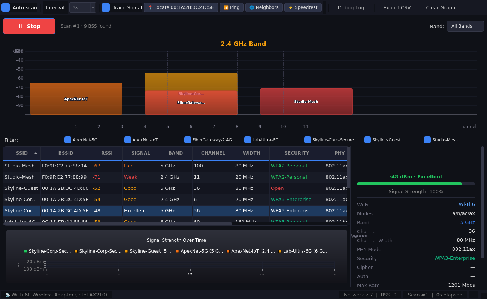
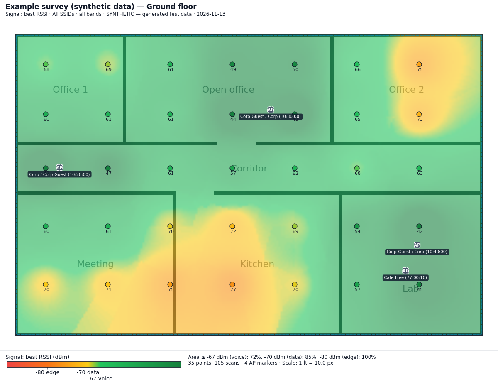

# WLAN Scan

Professional Wi-Fi network analysis and diagnostics tool. Built with Python and PySide6.



## Features

### Core Analysis
- **Visual Channel Map** — Networks positioned on their actual channel frequencies with width proportional to channel bandwidth (20/40/80/160 MHz) and height showing signal strength. Semi-transparent fills reveal overlapping networks. SSID labels rendered inside bars with outlined text for readability.
- **Real-Time Signal Graphs** — Track RSSI over time for any network. Auto-tracks the top 6 networks by signal strength. Select individual BSSIDs for isolated tracking.
- **Comprehensive Scanning** — SSID, BSSID, RSSI (dBm), channel, band, PHY mode, security details, channel utilization from 802.11 Information Elements.
- **Configurable Scan Interval** — Adjustable from 0.25s to 30s. Sub-second scanning for real-time observation of roaming and channel changes.
- **Adapter Capability Detection** — Reports supported bands (2.4/5/6 GHz) and Wi-Fi generations (n/ac/ax/be). Flags missing 6 GHz or 5 GHz capability with colored status indicators.

### Site Survey (Survey tab)
- **Floor plans** — Import PNG, JPG or PDF (pick the page of a multi-page PDF). Several floors per survey, each with its own plan, scale and points.
- **Scale calibration** — Click two points a known distance apart and type the distance (ft or m). Until then everything works in pixels and says so.
- **Point and walk modes** — Click where you stand and the app takes N scans there (default 3), or click a start point, walk, and click the next point to spread the scans taken on the way along the line. Optional 5-ping gateway check at each point.
- **Heatmaps** — Best RSSI, one BSSID's RSSI, coverage overlap (APs ≥ -67 dBm), co-channel APs, or channel utilization, filtered by SSID and band. Inverse-distance weighting clipped to a boundary you draw (or the points' outline plus a margin), with voice/data/edge thresholds (-67/-70/-80 dBm by default), legend and opacity.
- **APs on the plan** — Each AP's position is estimated from where it was heard strongest (its 2.4/5/6 GHz radios and SSIDs grouped by MAC); drag markers to the real spot or place them by hand.
- **Exports** — Heatmap PNG with title and legend, a CSV of every point × BSSID (x/y in feet), and a PDF report with one page per floor and metric.
- **Survey files** — Everything lives in one `.wlansurvey` file (a zip with the plans, settings and every scan). Autosaves every minute and offers to recover after a crash.



*Example heatmap rendered from the synthetic test survey in `tests/fixtures/` (modelled data, not a real site).*

### Network Diagnostics
- **Ping Test** — Pop-out window with continuous ping, real-time stats (sent/received/lost/min/avg/max), color-coded output, auto-scroll toggle, and gateway auto-detection. Multilingual output parsing (English, German, French, Spanish).
- **Neighbor Report** — ARP scan and subnet ping sweep to discover all devices on the local network. Correlates entries with known BSSIDs to label APs vs clients. Client isolation detection with a single glance. Vendor OUI lookup for every MAC address.
- **Speedtest** — Ookla CLI integration with large result cards (ping, jitter, download, upload), server and ISP info, color-coded quality thresholds, and one-click result sharing via speedtest.net.

### Security
- **WEP/WPA/WPA2/WPA3 Detection** — Parses RSN and WPA IEs for cipher suites (CCMP, TKIP, GCMP) and AKM suites (PSK, FT, SAE, SAE-EXT-KEY, 802.1X, Suite-B, OWE). Labels transition mode as "WPA2/WPA3" and shows PMF (required/capable/disabled) from RSN Capabilities.
- **Client Isolation Check** — The neighbor report shows whether AP isolation is active by comparing visible client devices to expected network activity.

### Quality of Life
- **Dark Theme** — Designed for extended use without eye strain. Consistent dark palette throughout all dialogs and widgets.
- **BSSID Tracking** — Track a specific BSSID across scans to watch for signal changes. Visual RSSI bar in the status bar.
- **Network Filtering** — Toggle individual SSIDs on/off in the channel map and signal graph.
- **Band Selection** — Filter views to 2.4 GHz, 5 GHz, or 6 GHz bands individually.
- **CSV Export** — Export the latest scan for analysis in spreadsheets or other tools (survey exports are in the Survey tab).
- **Vendor Lookup** — MAC OUI vendor identification from a bundled IEEE snapshot, offline and instant; randomized (locally administered) MACs are labelled as such.
- **Wi-Fi 6/6E/7 Support** — HE (802.11ax) and EHT (802.11be) detection; channel width and centre channel from the operation elements; max PHY rate computed from the MCS maps, spatial streams and width.

## Requirements

- Windows 10 or 11 (x64 or ARM64), or macOS 12+ (Intel or Apple Silicon)
- Python 3.10+, PySide6 and numpy (`requirements.txt`)
- A Wi-Fi adapter (built-in or USB)
- macOS 14+: allow Location Services for WLAN Scan (macOS hides SSIDs/BSSIDs otherwise; the app asks and explains)
- Linux: no live scanning yet; `--replay` plays back a recording, and the Survey tab works for opening and exporting surveys
- Ookla Speedtest CLI (optional, for speedtest feature — download from [speedtest.net/apps/cli](https://www.speedtest.net/apps/cli))

## Quick Start

```bash
# Clone
git clone https://github.com/bryjogar/wlan-scan.git
cd wlan-scan

# Create virtual environment (recommended)
python -m venv .venv
.venv\Scripts\activate        # Windows
source .venv/bin/activate     # macOS/Linux

# Install dependencies
pip install -r requirements.txt

# Run
python main.py
```

## Build & Release

- **Windows (folder):** `python build_exe.py` → `dist/WLAN Scan/` (portable folder, no install)
- **Windows (single file):** `python build_portable.py` → `dist/WLAN-Scan-Portable.exe` — one self-contained exe, no `_internal` folder. Slower to start (extracts to temp each run) but pushable to a client device by remote tooling that only moves one file.
- **macOS:** `python build_mac.py` → `dist/WLAN Scan.app` + zip (must run on a Mac)

### Release via GitHub Actions (recommended)

Tag a release and CI builds both platforms and publishes a GitHub Release:

```
git tag wlan-scan-v1.0.0
git push origin wlan-scan-v1.0.0
```

The workflow (`.github/workflows/wlan-scan.yml`) runs the test suite, builds
Windows + macOS, zips both, and creates a release with the downloads attached.
The in-app **Update available** link points at the latest release.

### CLI Mode

```bash
# Quick scan
python main.py --cli

# Scan and export CSV
python main.py --export

# Record every scan to a file, or play a recording back (GUI or --cli)
python main.py --record scans.jsonl
python main.py --replay scans.jsonl
```

### Tests

```bash
pip install -r requirements-dev.txt
QT_QPA_PLATFORM=offscreen python -m pytest -q
```

The suite runs headless on Linux (CI runs it on every push). Scanner code is
tested against recorded/synthetic fixtures in `tests/fixtures/`.

## Survey How-To

1. Open the **Survey** tab and click **+ Floor plan…** to import a PNG, JPG or PDF.
2. Click **Calibrate**, click both ends of something you know the length of (a wall, a door run), and type the distance.
3. Choose **Point**, stand somewhere, and click your position on the plan. A ring fills as the scans come in (set **Scans per point** first; tick **Ping gateway** to add latency/loss). Repeat around the site. **Undo point**, or right-click a point to retake or delete it.
4. Or choose **Walk**: click where you start, walk at a steady pace, click where you are at each turn. Scans taken in between are placed along each leg. Esc ends the walk.
5. The heatmap updates as you go. Pick the metric, SSIDs and band on the right; **Draw…** a boundary around the area you surveyed if the automatic one is off.
6. Grey dashed **AP** markers are estimates; drag them to where the APs really are, or **Place AP…** by hand.
7. **Survey ▾ → Save** writes the `.wlansurvey` file. **Export ▾** gives the PNG, CSV and PDF report.

Scans come from the scanner the Scanner tab uses. With Auto-scan off, each
point triggers its own scans; walk mode switches Auto-scan on.

## How It Works

### Windows Scanner (`scanner.py`)
Uses Windows' native `wlanapi.dll` via ctypes to:

1. **Open a WLAN handle** via `WlanOpenHandle()` with client version 2.0
2. **Trigger active scans** via `WlanScan()` and wait for the scan-complete notification (`WlanRegisterNotification`), so the interval you pick is the interval you get
3. **Retrieve BSS lists** via `WlanGetNetworkBssList()` — returns each BSS entry with RSSI in dBm, center frequency in kHz, PHY type, and raw 802.11 Information Elements
4. **Parse IEs** to extract channel utilization (BSS Load IE), security details (RSN/WPA IE), channel width (HT/VHT/HE Operation IE), station count, and more
5. **Look up vendors** from the bundled IEEE OUI snapshot (`resources/oui.txt.gz`, refreshed by `tools/build_oui.py` at build time)
6. **Detect adapter capabilities** via `WlanGetInterfaceCapability()` — reports supported PHY types, maps them to bands and Wi-Fi generations

### ARM64 Fallback (`pwsh_scanner.py`)
Windows on ARM has a known ctypes/libffi issue with wlanapi.dll. A PowerShell-based scanner bridges this gap using the same underlying Windows APIs via .NET P/Invoke, and its results go through the same IE parser. `backends.py` picks a scanner per platform and falls back down the list (wlanapi → PowerShell → netsh on Windows; CoreWLAN → airport on macOS); the status bar shows which one is active.

### Diagnostic Tools
- **Ping** — Uses `ping -t` on Windows with background threading and regex parsing for multilingual output
- **Neighbor Scan** — Uses `arp -a` for cached ARP entries plus a threaded ICMP ping sweep to populate the cache across the subnet
- **Speedtest** — Shells out to the Ookla Speedtest CLI (`speedtest --format=json --progress=yes`), parses JSON for bandwidth (bytes/sec → Mbps) and latency

## Architecture

```
wlan-scan/
├── main.py                    # Entry point (GUI or CLI; --record / --replay)
├── build_exe.py               # PyInstaller packaging script (Windows folder)
├── build_portable.py          # PyInstaller packaging script (Windows onefile)
├── build_mac.py               # PyInstaller packaging script (macOS bundle)
├── requirements.txt
├── tools/                     # build_oui.py (OUI snapshot), versioning.py, make_icns.py
├── wlan_scan/
│   ├── backends.py            # Scanner backend interface, per-platform picker and fallback
│   ├── scanner.py             # wlanapi.dll ctypes wrapper (Windows)
│   ├── scan_cycle.py          # Scan trigger → completion wait → read cycle, rate meter
│   ├── pwsh_scanner.py        # PowerShell/.NET fallback for Windows ARM64
│   ├── netsh_scanner.py       # netsh fallback (values are estimates)
│   ├── corewlan_scanner.py    # macOS CoreWLAN scanner
│   ├── airport_scanner.py     # macOS airport CLI fallback (macOS < 14.4)
│   ├── recording.py           # Record scans to JSON lines; replay backend
│   ├── bss.py                 # Raw BSS fields → BSSEntry (shared by all Windows paths)
│   ├── ie_parser.py           # 802.11 Information Element parser
│   ├── channels.py            # Frequency ↔ channel for 2.4/5/6 GHz
│   ├── vendors.py             # OUI vendor lookup (bundled snapshot)
│   ├── export.py              # Scan CSV writer
│   ├── connection.py          # Connected BSSID, default gateway
│   ├── models.py              # Data models (Network, BSSEntry, ScanResult)
│   ├── logging_setup.py       # Logging (14-day retention)
│   ├── updater.py             # Checks GitHub releases for a newer version
│   ├── version.py             # Version (set from the release tag at build time)
│   ├── resources/             # oui.txt.gz
│   ├── survey/
│   │   ├── project.py         # .wlansurvey model and file format, autosave
│   │   ├── plan_import.py     # PNG/JPG/PDF floor plans
│   │   ├── geometry.py        # Calibration, units, boundaries
│   │   ├── capture.py         # Point capture, walk-mode spreading
│   │   ├── metrics.py         # Heatmap metrics, filters, colour scales
│   │   ├── heatmap.py         # IDW grid (numpy), boundary mask
│   │   ├── aps.py             # AP position estimates and markers
│   │   ├── survey_csv.py      # Samples CSV
│   │   └── ping.py            # Short ping at a point
│   └── gui/
│       ├── main_window.py     # Main window (Scanner + Survey tabs), scan worker
│       ├── survey_tab.py      # Survey tab
│       ├── plan_view.py       # Pan/zoom floor plan view and click tools
│       ├── survey_dialogs.py  # Page picker, calibration, AP dialogs
│       ├── survey_export.py   # Heatmap PNG and PDF report
│       ├── heatmap_widgets.py # Heat layer image, legend
│       ├── channel_map.py     # Visual channel map widget (custom QPainter)
│       ├── signal_graph.py    # Real-time signal graph
│       ├── network_table.py   # Sortable/filterable network table
│       ├── detail_panel.py    # Network detail panel with IE breakdown
│       ├── bssid_tracker.py   # BSSID tracking with audio feedback
│       ├── ping_dialog.py     # Pop-out ping test with live stats
│       ├── neighbor_dialog.py # ARP scanner and client isolation check
│       ├── speedtest_dialog.py# Ookla speedtest with result cards
│       ├── background.py      # Run blocking calls off the GUI thread
│       └── styles.py          # Dark theme
├── docs/                      # v2 plan/status, README images
└── tests/                     # pytest suite (headless) + fixtures
```

### Data Flow
```
WlanScan() → WlanGetNetworkBssList()
    → parse BSS entries (frequency → channel/band, RSSI, PHY type)
    → parse raw IEs (RSN, HT/VHT/HE caps, BSS Load)
    → lookup vendors (MAC OUI → manufacturer)
    → emit ScanResult to GUI
        → Network Table (sortable rows)
        → Channel Map (frequency-positioned bars)
        → Signal Graph (time-series RSSI)
        → Detail Panel (IE drill-down)
        → Survey tab (stored at the current point → heatmap)
```

## Roadmap

### Completed
- [x] **macOS support** — Native scanner via CoreWLAN and `airport` CLI, platform-appropriate subnet detection, unified cross-platform backend interface
- [x] **Signal heatmap overlay** — Floor plan import, point/walk survey, heatmaps, AP placement, PNG/CSV/PDF export

### Next
- [ ] **Windows installer** — `.msi` or `.exe` package via PyInstaller / Inno Setup
- [ ] **Spectrum analysis integration** — Wi-Spy, MetaGeek, or other SDR hardware

### Later
- [ ] PCAP file import/export for offline analysis
- [ ] Remote sensor support (Raspberry Pi / secondary adapters)
- [ ] Channel utilization trending over time
- [ ] Alerting (new network detection, signal drops below threshold, rogue AP detection)
- [ ] Linux support (nl80211 / iw)

## License

MIT
